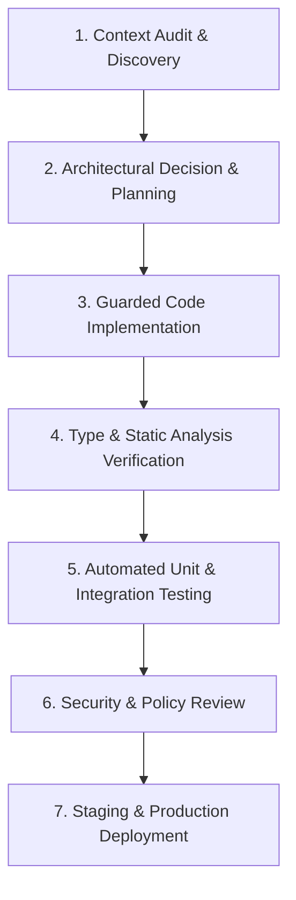

# AI-Assisted Development Workflow & Engineering Standards

_Project: SRE Platform (Start · Restart · Explore) · Engineering Governance Guide_

---

## 1. Principles of AI-Assisted Engineering

The SRE Platform embraces modern AI assistance (LLMs, code generation, automated audits) not to replace software engineering rigor, but to enhance velocity, consistency, and depth of analysis. Every line of code introduced or altered by an AI assistant must be verified, type-checked, and tested against real runtimes.

We adhere to the following principles:
1. **Never Accept Code Blindly:** Every AI-proposed change must undergo static verification (`tsc --noEmit`, ESLint) and functional testing before commit.
2. **Preserve Business Logic & Domain Identity:** AI must never simplify an architecture by deleting user features, removing existing models, or dumbing down complex algorithms.
3. **Transparency Over Fabrication:** Never fabricate human review certifications, compliance stamps, fake test metrics, or artificial performance stats.

---

## 2. The 7-Step Development Lifecycle

### Step 1: Context Audit & Discovery
- AI tools inspect existing schemas (`prisma/schema.prisma`), configuration files, route handlers, and component patterns before any code is modified.
- Legacy assumptions (e.g. SQLite vs PostgreSQL, relative vs absolute fetch) are verified by running commands in the environment.

### Step 2: Architectural Decision & Planning
- Architectural deviations or infrastructure changes are documented as Architectural Decision Records (ADRs) in `docs/ARCHITECTURAL_DECISIONS.md`.
- Backwards compatibility with existing user data and active sessions is established upfront.

### Step 3: Guarded Code Implementation
- Code modifications adhere to:
  - Single Responsibility Principle (SOLID).
  - Explicit error handling with structured JSON responses for API routes.
  - Safe data operations with atomic transactions (`db.$transaction`) for multi-step mutations.
  - No secrets embedded in frontend client bundles.

### Step 4: Type & Static Analysis Verification
- `npm run typecheck` (`tsc --noEmit`): Ensures strict TypeScript compliance with zero suppressions or build errors.
- `npm run lint` (`eslint .`): Enforces React hook rules, unused variables elimination, and modern ES standards.

### Step 5: Automated Testing
- `npm test`: Executes `node:test` suite covering level progression math, nutrition database lookups, authorization guards, and API configuration resolvers.
- Regressions are prevented by writing targeted tests for every fixed bug (see `docs/BUG_TRACKER.md`).

### Step 6: Security & Policy Review
- Code review checks against OWASP Top 10:
  - Input validation with Zod or type guards.
  - Authorization check on every sensitive mutating endpoint.
  - Prevention of timing attacks and hardcoded fallback secrets.
  - Google AdSense and crawler policy compliance (proper labels, no ads on restricted screens, valid `ads.txt`).

### Step 7: Deployment Verification
- Automated GitHub Actions CI workflow validates install, prisma schema, lint, typecheck, tests, and production build before deployment.
- Health checks (`/api/health`) verify database connectivity and runtime metrics post-deployment.

