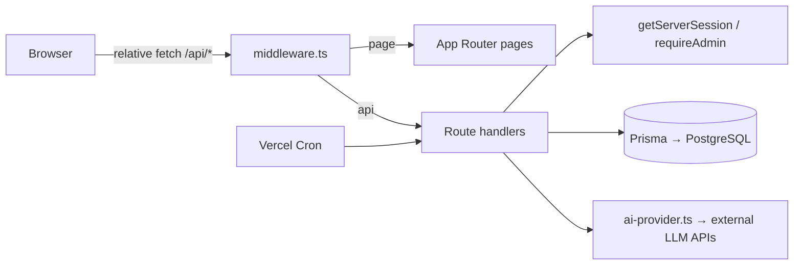

# Architecture Audit — SRE Platform (Start · Restart · Explore)

_Audit date: 2026-11-01 · Commit audited: `6782179` (main) · Auditor: AI-assisted (see `AI_DEVELOPMENT_WORKFLOW.md`), findings verified by running commands listed in §9._

## 1. Summary

SRE is a **single Next.js 15 (App Router) monolith**. UI pages, ~95 REST route handlers under `src/app/api/**`, NextAuth, and the Prisma data layer all live in one deployable unit currently shipped to Vercel. There is no separate backend service today.

| Concern | Current state |
|---|---|
| Framework | Next.js `^15.5.19`, React 19, TypeScript 5.8 (`strict`, but `noImplicitAny: false`) |
| Styling | Tailwind CSS 4 + shadcn/ui (Radix) + framer-motion |
| State | Zustand (`src/stores`), TanStack Query installed, most data fetched with raw `fetch` in client components |
| Auth | NextAuth v4, Credentials provider, JWT session (30 days) |
| ORM / DB | Prisma 6.19, `provider = "postgresql"` (Neon in prod per README). Optional libSQL/Turso adapter branch in `src/lib/db.ts` |
| Migrations | **None.** No `prisma/migrations/`. Schema applied with `prisma db push` inside the **Vercel build command** |
| AI | `src/lib/ai-provider.ts` — 5-tier fallback (Gemini → OpenAI → OpenRouter → Z.ai → Pollinations) via plain `fetch` |
| Jobs | One Vercel Cron: `/api/cron/learning-inactivity` daily 09:00 UTC |
| Tests | **None** (no test runner, no test files) |
| CI | `.github/workflows/deploy.yml` — lint & type-check are `continue-on-error: true` and `|| true` (failures ignored), deploys on every push to `main` |

## 2. Directory structure (relevant parts)

```
prisma/schema.prisma        51 models, PostgreSQL
prisma/db/dev.db            Stale SQLite file (43 tables, 1 user) — committed to git
src/app/(auth)/             login, signup
src/app/(main)/             ~25 authenticated screens (client components)
src/app/(public)/           marketing / SEO pages, blog, legal
src/app/admin/              admin console (client-side guard + server API guard)
src/app/api/                REST route handlers
src/app/{ads.txt,app-ads.txt,google…html}/route.ts   verification files served by handlers
src/app/{robots,sitemap,manifest,opengraph-image}.ts(x)
src/lib/                    auth, db, ai, gamification, nutrition databases, seed
src/middleware.ts           auth gate, guest mode, crawler allow-list, admin guard
skills/, examples/, mini-services/, download/, .zscripts/, agent-ctx/, upload/   tooling artefacts unrelated to runtime
```

`download/` contains two committed tarballs (`sre-platform-deploy.tar.gz`, `sre-platform-production-ready.tar`) — build artefacts that should not be in version control.

## 3. Request flow



All frontend calls use **relative URLs** (`fetch('/api/...')`) — verified: no absolute `fetch('http…')` in `src/`. This makes a frontend/backend split possible via a same-origin proxy without touching ~100 call sites (see ADR-001).

## 4. Authentication, sessions, RBAC

- `src/lib/auth.ts` — Credentials provider; bcrypt compare; suspended/banned users rejected; JWT carries `id, username, isAdmin, isSuperAdmin`.
- **JWT role claims are never refreshed** — a demoted admin keeps `isAdmin=true` in middleware for up to 30 days (API handlers re-check DB via `requireAdmin`, page-level admin gate does not).
- Secret fallback `'sre-platform-insecure-secret-please-set-nextauth-secret-env'` in **both** `auth.ts:59` and `middleware.ts:95`. If `NEXTAUTH_SECRET` is missing in any environment, sessions are forgeable.
- `src/lib/auth-helper.ts` — `getUserId()` throws on no session; routes catch and return 401.
- `src/lib/admin-auth.ts` — `requireAdmin()` checks `AdminRole` in DB. Super-admin also granted by a **hard-coded email** (`admin-auth.ts:5`).
- Guest mode: cookie `sre_guest=true` → middleware allows read-only paths and sets `x-guest` header; APIs call `rejectGuest()`.
- OTP phone login (`send-otp` / `verify-otp`) uses an **in-memory `Map`** and only `console.log`s the code — non-functional on serverless/multi-instance, see BUG_TRACKER.

## 5. Data layer

- 51 Prisma models across: core user, gamification, learning, fitness, content, time, social, messaging, moderation, AI memory/proposals, blogs.
- Many JSON blobs stored as `String` (e.g. `activePhases`, `images`, `tags`) — functional but unvalidated.
- Index coverage is partial: `Post`, `Comment`, `Notification`, `Conversation`, `Blog`, live-update models are indexed; high-traffic per-user tables (`TimeTask`, `FitnessFoodLog`, `FitnessWorkoutLog`, `FitnessWeightLog`, `LearningEntry`, `XPGain`, `UserQuest`, `FocusSession`, `DayPlan`, `Follow.followingId`, `DMMessage.conversationId`) have **no `(userId, date)` index**.
- `Blog.slug` has both `@unique` and `@@index([slug])` (redundant).
- `src/lib/db.ts` picks a libSQL adapter when `DATABASE_URL` starts with `http(s)://` — a misconfigured Neon HTTP URL would silently route to the Turso adapter.
- `prisma/db/dev.db` (SQLite) has 43 tables vs 51 models — it is stale and cannot be the production source of truth. Its single row is the admin user.

## 6. External integrations

| Integration | Where | Notes |
|---|---|---|
| Gemini / OpenAI / OpenRouter / Z.ai / Pollinations | `src/lib/ai-provider.ts` | Keys from env; 30 s timeout per tier → worst case ~150 s per request (exceeds typical serverless limits). Z.ai URL is `internal-api.z.ai` |
| Google AdSense | `src/app/layout.tsx`, `src/components/ad-banner.tsx`, `AdUnit.tsx` | Publisher `ca-pub-7745236489664493`; slot IDs are placeholders — see SEO_ADSENSE_AUDIT |
| Google Search Console | `src/app/google990ef60d3a371354.html/route.ts` | File verification |
| Vercel Cron | `vercel.json` | Learning inactivity notifications |
| SMS provider | — | **Not integrated** (OTP is simulated) |

## 7. Deployment configuration found

| File | Target | Status |
|---|---|---|
| `vercel.json` | Vercel | Build runs `prisma db push` (schema change on every deploy, no review) |
| `.github/workflows/deploy.yml` | Vercel via CLI | Ignores lint/type errors; seeds prod on each push; references non-existent `scripts/seed-production.ts/.mjs` |
| `DEPLOY.md`, `scripts/setup-turso.sh`, `deploy-complete.sh` | Turso | Contradicts README (Neon) |
| `production-ecosystem.config.js`, `start-production.sh`, `Caddyfile`, `.zscripts/*` | PM2 / Caddy in `/home/z/my-project` sandbox | Contain placeholder secrets and absolute paths of a previous dev sandbox |
| `deploy-to-vercel.sh` | Vercel | Hard-codes Vercel project/org IDs |
| `next.config.ts` | — | `typescript.ignoreBuildErrors: true`, `reactStrictMode: false` |

## 8. Hostless compatibility (verified against hostless.cloud docs)

Hostless runs Git-connected apps built by Railpack or a `Dockerfile`, requires binding to `0.0.0.0:$PORT`, supports HTTP health checks, workers and cron jobs via `hostless.yaml`. The current app:

- ✅ Node.js app with lockfile (`package-lock.json`) — buildable.
- ⚠️ `npm start` = `next start` without `-H 0.0.0.0 -p $PORT` → must be fixed.
- ⚠️ `next.config.ts` lacks `output: "standalone"` → large image; fine but slower.
- ⚠️ Health endpoint does not check the DB.
- ⚠️ Cron is Vercel-specific (`vercel.json`) → needs a Hostless `cron_jobs` entry calling the endpoint with `CRON_SECRET`.
- ⚠️ Long AI calls (up to 150 s) — acceptable on a long-running container, not on serverless.
- ✅ No filesystem persistence required at runtime (OTP map is the only in-memory state).

## 9. Baseline verification (commands executed)

| Check | Command | Result |
|---|---|---|
| Install | `npm install` | OK, 902 pkgs; npm reports 34 vulnerabilities (2 critical, 11 high) — `npm audit` could not reach registry from sandbox, re-run in CI |
| Prisma client | `prisma generate` | OK (was missing → `tsc` reported `PrismaClient` not exported) |
| Type check | `tsc --noEmit` | **9 errors** (framer-motion `ease` typing ×4, `achievements/route.ts:249`, `feed/live-updates/route.ts:295-298`) — hidden in builds by `ignoreBuildErrors` |
| Lint | `eslint src` | 0 errors, 2 warnings — but ~40 rules are disabled in `eslint.config.mjs` including `react-hooks/rules-of-hooks` |
| Tests | — | No test suite exists |
| Build | `next build` | See BUG_TRACKER baseline entry |

